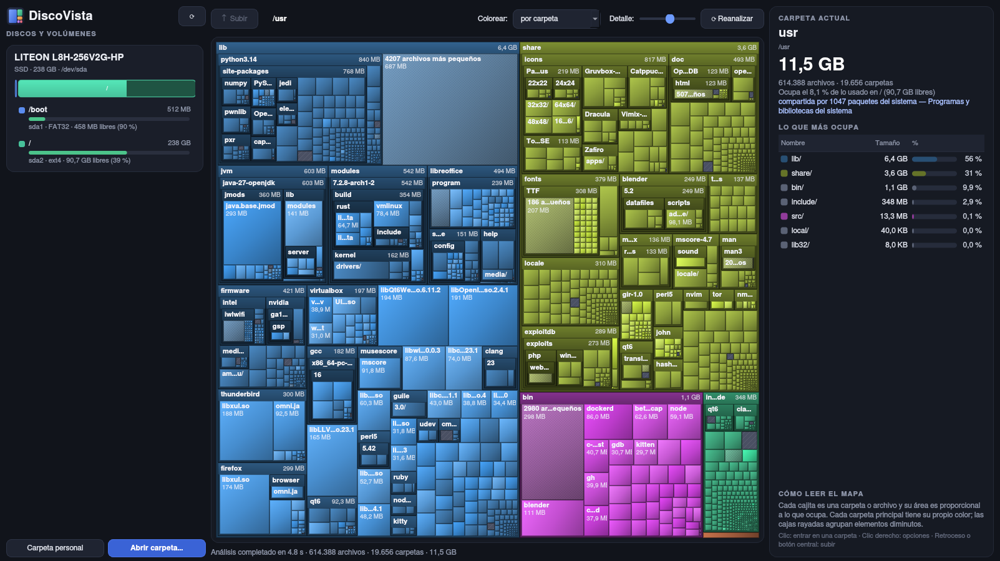
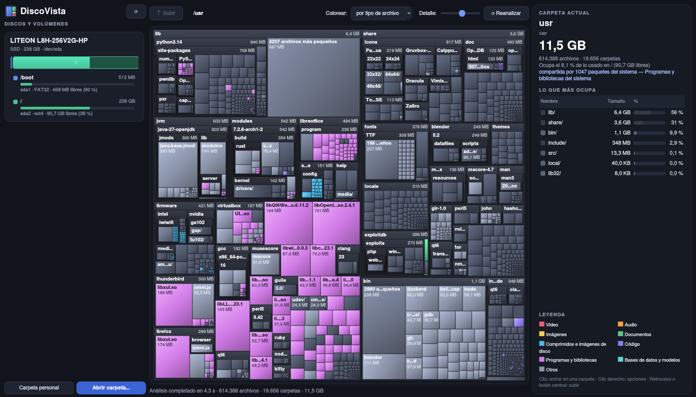
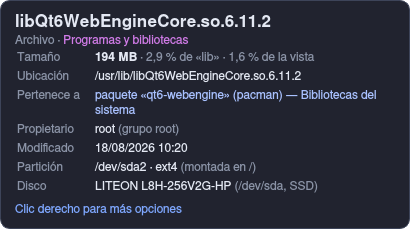

# DiscoVista

Explorador visual de discos para Linux: ves tus **discos, particiones y volúmenes** y, dentro de cada uno, un **mapa interactivo** donde cada carpeta y archivo es una cajita cuyo tamaño es proporcional a lo que ocupa. Así se ve de un vistazo qué es lo que más espacio gasta.



## Qué hace

- **Panel de discos**: cada disco con sus particiones (también LUKS, LVM y RAID), barra de uso, espacio libre y volúmenes de red/FUSE.
- **Mapa de árbol anidado** que se va dibujando en directo mientras se analiza.
- **Información al pasar el ratón** por cualquier cajita (archivo, carpeta, partición):
  - tamaño y porcentaje respecto a su carpeta y al total
  - ruta completa
  - **a qué pertenece**: el paquete de pacman que lo instaló y una descripción («Caché de npm», «Módulos del kernel», «Steam», «Entorno virtual de Python»…)
  - propietario, fecha de modificación, partición y disco donde está
- **Clic** para entrar en una carpeta, barra de ruta para volver, **Retroceso** o botón central del ratón para subir.
- **Clic derecho**: abrir en el gestor de archivos, copiar ruta, analizar solo esa carpeta o **mover a la papelera** (pide confirmación).
- Dos formas de colorear: **por carpeta** o **por tipo de archivo** (vídeo, audio, imágenes, documentos…).
- Lista lateral con lo que más ocupa en la carpeta actual.

| Por tipo de archivo | Información al pasar el ratón |
|---|---|
|  |  |

## Instalación

Necesita Python 3 y PyQt6.

### Arch Linux / Manjaro (paquete)

Descarga `discovista-1.0.0-1-any.pkg.tar.zst` de la [última release](https://github.com/melvinfranco99/discovista/releases/latest) e instálalo:

```bash
sudo pacman -U discovista-1.0.0-1-any.pkg.tar.zst
```

O compílalo con el `PKGBUILD` del repositorio: `makepkg -si`.

### Cualquier distribución (instalador)

```bash
git clone https://github.com/melvinfranco99/discovista.git
cd discovista
./install.sh              # para tu usuario, en ~/.local (no necesita sudo)
sudo ./install.sh --system   # o para todo el sistema, en /usr/local
```

Para desinstalar: `./install.sh --uninstall` (añade `--system` si lo instalaste así).

## Uso

```bash
discovista            # abre la ventana
discovista /ruta      # analiza directamente esa carpeta
```

También aparece en el menú de aplicaciones como **DiscoVista**.

Atajos: `Retroceso`/`Alt+↑` subir · `F5` reanalizar · `Ctrl+O` abrir carpeta · `Ctrl+Q` salir.

## Notas

- Los tamaños son **espacio real en disco** (como `du`), y los enlaces duros se cuentan una sola vez.
- El análisis no cruza a otros sistemas de archivos: un punto de montaje se muestra como una caja aparte que puedes analizar por separado.
- Las carpetas que tu usuario no puede leer se indican y no se cuentan.

## Licencia

MIT
